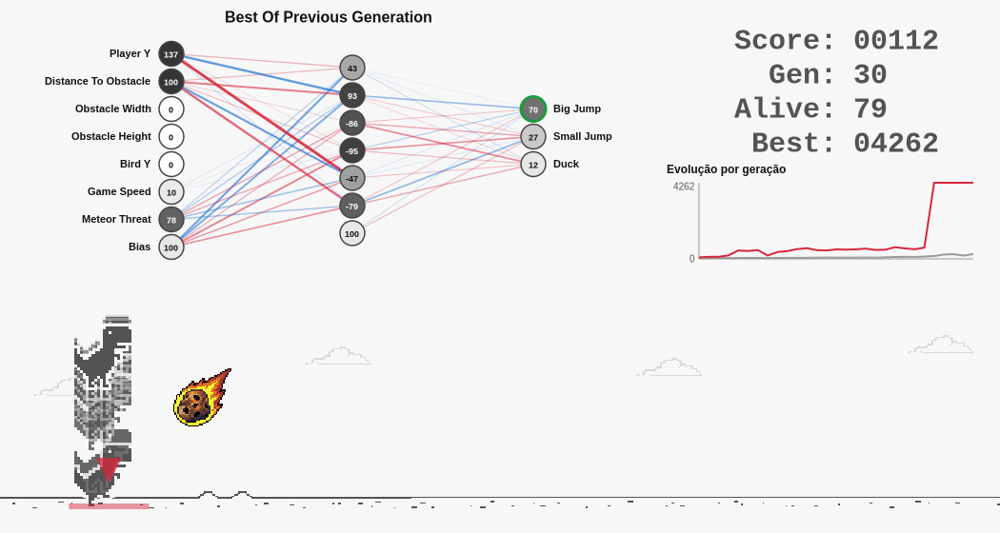

# Dino Genetic Algorithm

Neuroevolução em JavaScript puro: dezenas de dinossauros aprendem sozinhos a jogar o Dino do Chrome.
Cada um tem uma rede neural própria; a cada geração os melhores se reproduzem (cruzamento + mutação) e o
campeão é sempre preservado. A rede do melhor dino aparece sobre o jogo, com os valores e sinais ao vivo.



## Como funciona

**Algoritmo Genético** — a cada geração:

1. **Avaliação:** todos os dinos jogam ao mesmo tempo na mesma pista; a aptidão é a distância percorrida.
2. **Elitismo:** os melhores genomas passam intactos (o campeão e o recordista histórico nunca se perdem).
3. **Seleção por torneio, cruzamento uniforme e mutação gaussiana** geram o restante da população.
4. **Imigrantes aleatórios** mantêm a diversidade genética.

**Cérebro de cada dino** — rede neural feed-forward `8 → 6 → 3` (pesos evoluídos, sem gradiente):

| Entradas (sensores) | Saídas (ações) |
|---|---|
| Player Y, Distance To Obstacle, Obstacle Width, Obstacle Height, Bird Y, Game Speed, Meteor Threat, Enemy Speed | Big Jump, Small Jump, Duck |

A física e as regras de obstáculos seguem o jogo original do Chromium (pulo variável, pássaros em 3 alturas,
velocidade crescente).

**Fase noturna** — como no Dino original, a tela escurece (modo escuro), mas aqui de forma equilibrada: **500 pontos de dia e
500 de noite**, alternando, com transição gradual. À noite o fundo vira um cenário de cidade em ruínas no deserto, que rola
em paralaxe com a estrada na velocidade do chão, e os cactos dão lugar aos **inimigos noturnos: zumbis e esqueletos**, que
andam em direção ao dino (por isso chegam mais rápido que a pista). A rede neural, o placar e o gráfico trocam de cores
para continuar legíveis.

**Sem limite de tempo** — cada geração só termina quando **todos** os dinos morrem. Um dino bom joga para sempre; o jogo
nunca é reiniciado por ter atingido uma pontuação.

**Meteoros** — para aumentar a dificuldade, de tempos em tempos um meteoro cai em diagonal **mirando os dinos**.
Um aviso vermelho pulsa no chão no ponto do impacto, e só sobrevive quem estiver no ar quando o meteoro chega ao chão.
O jogo é justo: quando chega a hora do meteoro, a criação de cactos pausa, os que já estão na tela passam, e só então
ele cai — sempre existe um pulo que salva.

## Executar

Requisitos: **Node.js 20+** (apenas para o servidor local e os testes; não há dependências npm) e um navegador moderno.

```bash
npm start      # servidor local em http://127.0.0.1:8080
npm test       # testes automatizados
npm run simulate   # experimento: qual tamanho de população é melhor?
npm run format     # formata o código (Prettier, 120 colunas)
```

> Abrir o `index.html` com duplo clique **não funciona**: módulos ES exigem HTTP. Use `npm start`.

**GitHub Pages:** o projeto é 100% estático. Em *Settings → Pages*, escolha *Deploy from branch* → `main` → `/ (root)`
e o jogo fica online.

### Controles

| Controle | Efeito |
|---|---|
| `1x` `2x` `5x` `10x` `MAX` | Velocidade da simulação (use MAX para treinar rápido) |
| `Espaço` / Pausar | Pausa e retoma |
| Reiniciar evolução | Volta à geração 1 e apaga o campeão salvo |

O melhor dino é salvo no `localStorage` e volta como ponto de partida na próxima visita.

### Lendo a rede neural

- O número em cada neurônio é o valor atual em escala 0–100 (entradas normalizadas; saídas de 0 a 100).
- As linhas acendem conforme o sinal que passa por elas (azul = positivo, vermelho = negativo).
- A saída com contorno verde (acima de 50) é a ação em execução.

## Estrutura

```
.
├── index.html
├── styles/main.css
├── assets/
│   ├── sprites/                    dino-sprite.png, meteor-sprite.png, night-enemies.png
│   └── scenery/                    ruined-city-backdrop.png, ruined-city-road.png (camadas da fase noturna)
├── scripts/
│   ├── dev-server.mjs              servidor estático local (seguro, sem dependências)
│   └── simulate-population.mjs     experimento de tamanho de população
├── src/
│   ├── main.js                     ponto de entrada
│   ├── app/                        Application (liga as peças), GameLoop (tempo e velocidade), verificação de ambiente
│   ├── config/                     configurações imutáveis: jogo, IA e interface
│   ├── game/                       Dino, Obstacle, ObstacleField, Meteor, MeteorShower, DayNightCycle, Track, GameSession (sem DOM)
│   ├── ai/
│   │   ├── agent/                  Agent (corpo + cérebro + DNA) e Sensor
│   │   ├── genetic/                Genome e GeneticAlgorithm
│   │   ├── neural/                 NeuralNetwork e topologia
│   │   └── training/               EvolutionTrainer (ciclo evolutivo)
│   ├── persistence/                GenomeStorage (salva o campeão com validação)
│   ├── rendering/                  desenho no canvas: jogo, cenário, rede neural, HUD, gráfico, paleta dia/noite
│   ├── ui/                         ControlPanel
│   └── utils/                      SeededRandom, RingBuffer (fila circular), validação, matemática
├── tests/unit/                     testes espelhando a estrutura de src/
└── docs/                           arquitetura e resultados do experimento
```

Detalhes de projeto em [`docs/ARCHITECTURE.md`](docs/ARCHITECTURE.md).

## Testes e experimento

```bash
npm test
```

Cobrem física e colisões, sensores, rede neural, algoritmo genético, treinador (incluindo reprodutibilidade por
semente), persistência com dados corrompidos e renderização (com um canvas simulado).

O tamanho de população padrão (**150 dinos**) vem de um experimento com 10 sementes por tamanho —
veja [`docs/POPULATION_EXPERIMENT.md`](docs/POPULATION_EXPERIMENT.md).

## Configuração

Os hiperparâmetros ficam em [`src/config/aiConfig.js`](src/config/aiConfig.js):

| Parâmetro | Padrão | Descrição |
|---|---|---|
| `populationSize` | 150 | Dinos por geração |
| `hiddenLayers` | `[6]` | Neurônios por camada escondida |
| `eliteCount` | 5 | Genomas preservados sem alteração |
| `mutationRate` | 0.15 | Chance de cada gene mutar |
| `minMutationStrength` / `maxMutationStrength` | 0.02 / 0.5 | Faixa da força de mutação (sorteada por filho) |
| `immigrantRate` | 0.04 | Fração de indivíduos novos por geração |
| `maxFramesPerGeneration` | 15000 | Teto de duração de uma geração, usado só em simulações sem interface (`npm run simulate`); a interface joga sem limite |

## Desempenho

Medido com `node` neste repositório (mesma simulação, código antigo contra o novo, 8 execuções alternadas, tempo de CPU):
a mesma tarefa levou **1196 ms antes e 850 ms depois** (mediana). Os resultados da simulação são idênticos aos de antes.

- **Só os vivos jogam.** Numa geração típica 77% dos dinos já morreram. A sessão guarda uma lista de trabalho só com os
  vivos (tira da lista trocando com o último), então o laço processa em média 35 dinos por passo em vez de 150.
- **A pista é lida uma vez por passo.** Todos os dinos veem o mesmo obstáculo e o mesmo meteoro; o `Sensor` observa a
  pista uma vez e cada dino só calcula o que é só dele.
- **Colisão só quando há o que colidir.** A pista marca, a cada passo, se algo está na faixa horizontal do dino. Na maior
  parte do tempo não está, e ninguém chama a checagem.
- **Estruturas de dados.** Obstáculos e histórico entram por um lado e saem pelo outro (fila), então usam `RingBuffer`;
  uma pilha tiraria sempre o mais novo. Detalhes em [`docs/ARCHITECTURE.md`](docs/ARCHITECTURE.md).
- **Menos alocação por quadro.** Sem geradores nem listas temporárias no desenho; o histórico, a paleta, o layout da
  rede e os estilos do cenário são calculados uma vez e reaproveitados.
- **Imagens.** O cenário foi de 247 KB para 69 KB (128 cores, erro médio de cor de ~1,8 em 255).
- **O que não ajudou:** mexer nos laços internos da rede neural não deu ganho medido (o motor já otimiza), então ficou
  simples. Há um teste que compara a rede com uma implementação de referência.

## Segurança

- Política de segurança de conteúdo (CSP) restritiva: só recursos do próprio site, sem conexões externas.
- Nenhum uso de `innerHTML`/`eval`; a interface é criada com `createElement` e `textContent`.
- Dados do `localStorage` são tratados como não confiáveis: validados em tamanho, formato, tipo e intervalo.
- Estado interno encapsulado (campos privados `#`), configurações congeladas (`Object.freeze`) e argumentos validados nas
  bordas: tipo errado lança `TypeError`, valor fora do limite lança `RangeError`.
- Servidor local restrito a `127.0.0.1`, com lista de arquivos permitidos e proteção contra *path traversal*.

## Créditos e licença

Código sob licença [MIT](LICENSE). Os sprites do dino e as constantes de física derivam do jogo do Chromium
(licença BSD) — veja [`THIRD_PARTY_NOTICES.md`](THIRD_PARTY_NOTICES.md), que também registra a origem do sprite do meteoro.
