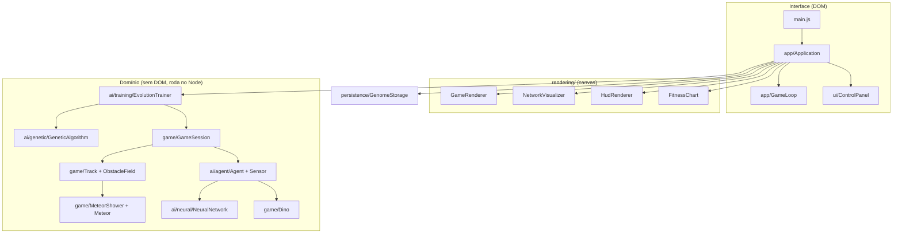

# Arquitetura

## Camadas

A regra de dependência é de cima para baixo: o **domínio nunca importa DOM, canvas ou renderização**. Por isso a
mesma simulação roda no navegador, nos testes e no experimento de população (`npm run simulate`).

## Fluxo de uma geração

1. `EvolutionTrainer` cria um `Agent` para cada `Genome` da população e uma `GameSession` com uma pista nova.
2. A cada passo (1/60 s), `GameSession` atualiza a `Track` (velocidade, obstáculos) e, para cada agente vivo:
   `Sensor` lê o ambiente → `NeuralNetwork` calcula as saídas → `Agent` converte em ação (pular/agachar)
   → `Dino` aplica a física → colisão encerra o agente e grava a aptidão (distância percorrida).
3. Quando todos morrem, `GeneticAlgorithm.evolve()` gera a próxima população. A interface joga **sem limite de
   tempo** (`infiniteMode`); `maxFramesPerGeneration` é só um teto para simulações e testes sem interface, que
   precisam terminar (o padrão do domínio).
4. O campeão fica na posição 0: é o "melhor da geração anterior" exibido na tela.

## Fase noturna e cenário

`DayNightCycle` (domínio, sem DOM) calcula a escuridão (0 a 1) em função da pontuação: 500 pontos de dia, 500 de noite,
repetidamente, com transições de 50 pontos no início e no fim da noite.

**Inimigos noturnos.** Cada tipo de obstáculo tem uma `phase` (`day`, `night` ou `any`): cactos só de dia, zumbis e
esqueletos só de noite, pássaros nos dois. Os inimigos andam em direção ao dino (`speedOffset`), e a rede recebe essa
velocidade pelo sensor `Enemy Speed`, porque o momento certo do pulo depende dela.

**Espaçamento justo entre velocidades diferentes.** Como zumbis são mais rápidos que a pista, um zumbi nascendo logo
atrás de um cacto o alcançaria e não deixaria tempo para o dino pousar. Por isso `ObstacleField` sorteia o próximo
obstáculo com antecedência e só o faz nascer quando o **tempo de chegada** dele ao dino fica pelo menos
`last.gap / velocidade` depois do anterior (com a mesma velocidade, equivale à regra do jogo original).
Teste: uma regra manual que pula com pulo pequeno sobrevive 80 mil passos em 30 de 30 sementes, com noites, inimigos e
meteoros.

No desenho, `GameRenderer` lê `track.darkness` e combina:

- **Cenário** (`Scenery`): duas camadas que repetem na horizontal. O fundo (céu, cidade, dunas) rola a 12% da velocidade
  do chão (paralaxe) e a estrada rola junto com o chão, então os obstáculos "correm" sobre ela.
- **Sprites invertidos**: `SpriteSheet.createInverted()` gera uma única vez, ao carregar, a folha com as cores invertidas
  (como o modo escuro do Dino original) para cactos e pássaros. Durante a transição, desenham-se as duas versões com
  opacidades complementares. Zumbis e esqueletos mantêm as cores originais.
- **Líder em destaque**: o campeão (ou, se ele morrer, o primeiro dino vivo) é desenhado opaco e por último; os demais
  ficam translúcidos. Sem isso, depois de várias gerações, os poucos sobreviventes translúcidos pareciam sumir.
- **Paleta da interface** (`palette.js`): rede neural, placar e gráfico trocam de cores (e ganham um painel escuro) para
  continuar legíveis sobre o cenário. As paletas ficam em cache por nível de escuridão.

## Meteoros e justiça

`MeteorShower` cria no máximo um meteoro por vez, com trajetória diagonal calculada para terminar no chão, na posição
do dino (com pequeno erro de mira). O meteoro só colide nos últimos passos antes do impacto, então a defesa é estar
no ar nesse momento. O sensor `Meteor Threat` (0 sem meteoro, subindo até 1 no impacto) permite à rede reagir.

Um meteoro que cai junto de um cacto pode ser **impossível de vencer** (o dino precisa pular para os dois ao mesmo
tempo). Por isso, quando chega a hora, o `MeteorShower` entra em "evento de meteoro": pausa a criação de obstáculos
(`ObstacleField.pauseSpawningUntil`), espera a pista esvaziar e o dino pousar (`ObstacleField.isCalm`) e só então
solta o meteoro, mantendo uma pausa curta depois. Isso garante que sempre exista uma defesa, em qualquer velocidade.
Testes: um dino que ignora o meteoro morre no primeiro; uma regra manual que pula com antecedência sobrevive sempre.

Os meteoros usam um fluxo aleatório próprio (`rng.fork()`), então ligá-los ou desligá-los não altera a sequência de
obstáculos.

## Estruturas de dados

| Onde | Estrutura | Por quê |
|---|---|---|
| Obstáculos (`ObstacleField`) | `RingBuffer` (fila circular) | Entram à direita e saem à esquerda: é uma fila. Pilha não serve, porque tira sempre o mais novo. Sair do começo é O(1); `Array.shift()` move todos os itens. |
| Histórico de gerações | `RingBuffer` com limite | Mesma ideia: janela das últimas N gerações, e a tela lê uma cópia imutável que só é refeita quando o histórico muda. |
| Dinos vivos (`GameSession`) | vetor de trabalho com "troca com o último" | Sair da lista em O(1), sem ordem. A lista completa (com os mortos) fica à parte, só para desenhar e para saber quem é o primeiro vivo. |
| Repetição de tipo de obstáculo | dois campos (último tipo e contador) | Só interessa quantos iguais seguidos: não precisa guardar lista. |
| Pesos e genes | `Float64Array` | Memória contínua e sem conversão. |

## Encapsulamento

Todo estado é campo privado (`#`). `Track` esconde obstáculos e meteoros atrás de métodos (`nextObstacle`,
`forEachObstacle`, `meteor`, `collides`); quem desenha ou sente a pista não recebe os objetos internos. `Genome`
e `NeuralNetwork` só entregam cópias. Argumentos são validados nas bordas: tipo errado lança `TypeError` e valor fora
do limite lança `RangeError`.

## Decisões de projeto

- **Determinismo.** Toda aleatoriedade passa por `SeededRandom` (mulberry32). Com a mesma semente, a simulação inteira
  é idêntica — base dos testes de reprodutibilidade e do experimento de população.
- **Passo fixo.** A simulação avança em passos de 1/60 s independentes da taxa de quadros; a velocidade 2x/10x/MAX
  apenas executa mais passos por quadro desenhado.
- **Pista compartilhada.** Todos os dinos de uma geração enfrentam os mesmos obstáculos, o que torna a comparação
  de aptidão justa. Cada geração usa uma pista nova, evitando decorar um único percurso.
- **Elitismo + recordista histórico.** O melhor da geração e o melhor de todos os tempos sempre sobrevivem intactos.
- **Mutação multi-escala.** Cada filho sorteia a força da mutação em escala logarítmica (0,02 a 0,5): alguns filhos
  fazem ajuste fino do que já funciona, outros exploram. Foi a mudança que tornou o aprendizado estável, porque a
  janela de tempo do pulo é estreita.
- **Sensores com zero como "sem perigo".** Entradas de perigo ausente valem 0 (`Bird Y`, `Meteor Threat`). Se "sem
  meteoro" valesse 1 (igual a "longe"), ajustar o peso dessa entrada alteraria o comportamento mesmo sem meteoro.
- **Normalização dos sensores.** A distância é normalizada por 250 unidades (e não pela largura do mundo) para que o
  limiar de pulo caia numa faixa fácil de ajustar com pesos pequenos.
- **Encapsulamento.** Estado em campos privados (`#`); leituras por getters; vetores internos nunca saem
  (`Genome.toArray()` e `NeuralNetwork.snapshot()` devolvem cópias); configurações congeladas com `deepFreeze`.
- **Validação nas fronteiras.** Construtores validam argumentos (`utils/validation.js`) e o `GenomeStorage` valida
  tudo o que lê do `localStorage`.
